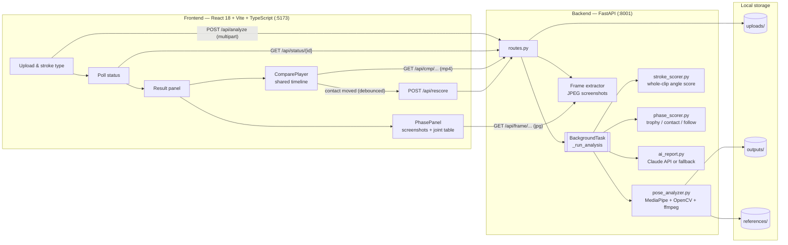

# TennisVision AI

AI-assisted tennis stroke analysis from ordinary phone video. Upload a clip, and TennisVision AI
extracts a 33-point body skeleton frame by frame, finds the key moments of the stroke, scores
your joint mechanics against a professional reference (currently Elena Rybakina's serve), and
plays your stroke side by side with the pro, synchronised at the moment of ball contact.

> Status: beta / local prototype. Serve is the most complete stroke (pro comparison and
> phase scoring). Other stroke types get skeleton overlay and rule-based angle scoring only.

---

## Contents

- [Features](#features)
- [Architecture](#architecture)
- [Analysis pipeline](#analysis-pipeline)
- [Methods](#methods)
  - [Video normalisation](#1-video-normalisation)
  - [Pose estimation](#2-pose-estimation)
  - [Contact-point detection](#3-contact-point-detection)
  - [Comparison clips](#4-comparison-clips)
  - [Face masking](#5-face-masking)
  - [Phase detection](#6-phase-detection-trophy--contact--follow-through)
  - [Phase scoring](#7-phase-scoring-vs-the-pro)
  - [Whole-clip angle score (legacy)](#8-whole-clip-angle-score-legacy)
  - [Coaching report](#9-coaching-report)
  - [Synchronised playback](#10-synchronised-playback)
- [API reference](#api-reference)
- [Project structure](#project-structure)
- [Getting started](#getting-started)
- [Configuration](#configuration)
- [Privacy](#privacy)
- [Known limitations](#known-limitations)
- [Roadmap](#roadmap)

---

## Features

| Feature | Description |
|---|---|
| **Skeleton overlay** | MediaPipe Pose (33 landmarks) drawn on every frame, with joint angles and error labels such as "Elbow too bent". |
| **Pro comparison player** | Your clip and the pro's clip side by side, aligned so both players hit the ball at the same instant. One shared speed control (1× / 0.5× / 0.25× / 0.1×, default 0.25×). |
| **Manual contact fine-tuning** | Drag the progress bar under *your* video (or step ±1 frame) to correct the auto-detected contact frame. Alignment and phase scores update live. |
| **Phase-by-phase scoring** | Trophy position, contact and follow-through are detected in both clips. Five joint angles are compared with the pro at the same phase, with side-by-side screenshots. |
| **Skeleton-only view** | Toggle between skeleton-on-video and skeleton-on-dark-background for both comparison clips. |
| **Face masking** | The player's face in uploaded videos is pixelated in every processed output. |
| **Bilingual coaching report** | English / Chinese summary and tips, generated by Claude (with a rule-based fallback when no API key is configured). |
| **EN / 中文 UI** | One-click language toggle. |

---

## Architecture



**Design notes**

- **Async by polling.** `POST /api/analyze` stores the upload, returns a `task_id` immediately
  and runs the heavy work in a FastAPI `BackgroundTask`. The frontend polls
  `/api/status/{task_id}` every 2 s.
- **Videos are rendered once, server-side.** All skeleton drawing, face masking and trimming
  happen in Python, and the browser only plays MP4s. Screenshots for the phase panel are cut on
  demand from the already-rendered comparison clip, so they always match what the player shows.
- **The reference is processed lazily.** The pro video is analysed on first use and cached in
  memory (`_ref_cache`), with its rendered clips written to `references/`.
- **The Vite dev proxy** forwards `/api/*` to `localhost:8001`, so the frontend uses relative
  URLs everywhere.

---

## Analysis pipeline

For each upload, `_run_analysis` in `backend/app/api/routes.py` runs these steps:

```
upload ─► 1 normalise rotation (ffmpeg)
       ─► 2 full-length annotated video        analyze_video()            → outputs/{id}_annotated.mp4
              • pose per frame, angles, error labels, face mask
              • mean joint angles over the clip
       ─► 3 comparison clip pair               process_comparison_pair()  → outputs/{id}_cmp_overlay.mp4
              • pass 1: find contact frame                                   outputs/{id}_cmp_skeleton.mp4
              • pass 2: render ±4 s window, collect per-frame features
       ─► 4 whole-clip score                   stroke_scorer.score_stroke()
       ─► 5 coaching report                    ai_report.generate_report()
       ─► 6 reference (cached)                 process_comparison_pair(ref, ±2 s)
       ─► 7 phase detection + scoring          phase_scorer.detect_phases / score_phases
       ─► task status = completed  (analysis + compare + phase_analysis)
```

---

## Methods

### 1. Video normalisation

Phone videos usually store orientation as rotation metadata, which OpenCV ignores. Each input is
first re-encoded with ffmpeg (`libx264`, `yuv420p`, audio dropped), so the rotation is baked into
the pixels. ffmpeg comes bundled through `imageio-ffmpeg` (installed with `moviepy`), so no system install is needed.
Outputs are re-encoded to H.264 for browser playback.

### 2. Pose estimation

[MediaPipe Pose](https://developers.google.com/mediapipe) (`model_complexity=1`, temporal
smoothing on) returns 33 landmarks per frame. Joint angles are the angle at the middle point of
three landmarks:

```
angle(A, B, C) = arccos( (A−B)·(C−B) / (|A−B| |C−B|) )
```

Phase features are computed in **pixel** coordinates, so non-square frames don't distort angles.
Per frame, `frame_features()` records:

| Feature | Landmarks |
|---|---|
| Elbow (L/R) | shoulder – elbow – wrist |
| Shoulder (L/R), i.e. upper-arm elevation | hip – shoulder – elbow |
| Knee (L/R) | hip – knee – ankle |
| Trunk tilt | angle of hip-midpoint → shoulder-midpoint from vertical |
| Wrist height (L/R) | normalised y of each wrist |

### 3. Contact-point detection

During a serve, **each wrist reaches its highest point once**. The toss arm peaks first, at
release, and the racket arm peaks at contact. The detector therefore median-smooths both wrist
height series (3 frames), finds each wrist's highest frame, and takes the **later** of the two
as contact.

This rule doesn't depend on handedness, or on whether MediaPipe labels the left and right arms
correctly. That matters for players facing the camera, where the labels are often swapped. The
same rule decides which arm holds the racket for phase scoring.

On small, motion-blurred amateur footage the detected frame can land a few frames early, which
is why the UI provides [manual fine-tuning](#10-synchronised-playback).

### 4. Comparison clips

`process_comparison_pair()` makes two passes:

1. **Pass 1** runs pose on every frame to find the contact frame.
2. **Pass 2** renders a window around contact into two synchronised files: skeleton on video
   (`_cmp_overlay`) and skeleton on a dark canvas (`_cmp_skeleton`). It also records per-frame
   features for phase scoring.

The window is **±4 s for your clip** and **±2 s for the reference**. Your clip carries more
lead-in, so it starts playing first and there is room to move the contact point by hand. The
window is clipped at the start and end of the video. The function returns the contact frame
relative to the trimmed clip.

### 5. Face masking

`FaceMasker` builds a square box from MediaPipe's face landmarks (0–10: nose, eyes, ears,
mouth). The box is sized as `max(1.9 × face-landmark span, 0.75 × shoulder width, 4% of frame)`,
shifted up slightly to cover the hairline. The region is pixelated to a 6-block mosaic before the
skeleton is drawn, and face landmark dots are hidden.

If pose detection drops out, the last box is held for up to 15 frames, so the face never flashes
through. Masking applies to uploaded videos only, not the reference.

### 6. Phase detection (trophy / contact / follow-through)

`phase_scorer.detect_phases()` finds the three key moments in **both** clips with the same rules:

| Phase | Rule | Search window |
|---|---|---|
| **Racket arm** | wrist whose highest point comes later | whole clip |
| **Trophy position** | toss-arm wrist at its highest | 1.2 s → 0.1 s before contact |
| **Contact** | detected contact, or the user's manual override | — |
| **Follow-through** | racket-arm wrist at its lowest | 0.1 s → 0.6 s after contact |

If a phase frame has no pose, the nearest frame within ±5 that has one is used.

> Why not "deepest knee bend" for the trophy position? It works for pros but fails for
> juniors and recreational players who barely bend their knees. It picked frame 1 on our
> test footage. The toss-arm peak is reliable for both.

### 7. Phase scoring vs. the pro

At each phase, five angles are compared with the pro's angles **at the same phase**:

| Joint | Meaning |
|---|---|
| Racket-arm elbow | arm extension (≈180° = straight) |
| Racket-arm shoulder | upper-arm elevation relative to the torso |
| Toss-arm shoulder | toss arm up at trophy, tucked in by contact |
| Knee (avg of both) | leg drive and load |
| Trunk tilt | lean of the torso from vertical |

Per joint, with `d = |your angle − pro angle|`:

```
score = 100                          if d ≤ 8°
score = max(0, 100 − 2·(d − 8))      otherwise          (0 at d ≥ 58°)
status = good (d ≤ 12°) · warning (d ≤ 25°) · poor
```

A **phase score** is the mean of its joint scores, and the **phase overall score** is the mean of
the three phases. When you move your contact point in the player, the frontend calls
`POST /api/rescore/{task_id}` (debounced 500 ms). The backend re-detects all three phases from
the new contact frame and returns fresh scores and screenshot URLs.

### 8. Whole-clip angle score (legacy)

The original MVP score, still shown at the top of the result:

1. Average each joint angle over **all frames** of the clip.
2. Compare the average with a hand-set reference range per stroke type, for example serve
   right elbow 130–170°. With `mid` = range centre, `h` = half-width and `e` = how far the
   average falls outside the range:
   - inside the range → **100** (good)
   - `e ≤ 0.5h` → linear 100 → 70 (warning)
   - beyond that → `100 − 60·e/h`, floored at 0 (poor)
3. Overall = mean of the joint scores.

This score averages preparation, swing and recovery together, assumes a right-handed player and
only has ranges for serve, forehand and backhand. Prefer the phase score for serves.

### 9. Coaching report

`ai_report.py` sends the overall score and per-joint feedback to **Claude**
(`claude-sonnet-4-6`). It asks for a JSON object with a 2–3 sentence summary and 3–5 actionable
tips in both English and Chinese.

If no API key is configured, or the call or JSON parsing fails, a rule-based report is produced
instead: a summary chosen by score band, plus a tip for each poor or warning joint. The AI only
writes text. It never changes scores.

### 10. Synchronised playback

The comparison player drives both `<video>` elements from one **shared timeline**:

```
τ           = seconds relative to contact (τ = 0 at ball strike), in media time
pro time    = ref_contact  + τ
your time   = your_contact + τ        (your_contact = auto-detected + manual offset)
τ range     = [ −max(ref_contact, your_contact),  max(ref_len − ref_contact, your_len − your_contact) ]
```

- A `requestAnimationFrame` loop advances τ at the selected speed.
- Each video plays natively at that `playbackRate`. It is re-seeked only when it drifts more
  than 60 ms (20 ms below Chrome's 0.0625× rate floor), which avoids seek thrash.
- A clip whose position is still before 0 holds its first frame. Usually your clip starts first
  and the pro starts later, and both reach contact together.
- **Dragging your own progress bar** moves only your video while the pro frame stays put. The
  new pairing becomes the alignment: `your_contact = position − τ`. Workflow: click
  **🎾 Contact**, then drag your bar to the frame where you hit the ball.
- The selected speed persists in `localStorage`. A new analysis remounts the player, so every
  upload starts clean.

---

## API reference

All routes are prefixed with `/api`.

| Method | Path | Description |
|---|---|---|
| `POST` | `/analyze` | Multipart upload: `video` file and `stroke_type`. Returns `{task_id, status: "processing"}`. |
| `GET` | `/status/{task_id}` | Task state, with `analysis`, `compare` and `phase_analysis` once completed. |
| `POST` | `/rescore/{task_id}` | Body `{"user_contact_sec": float}`. Re-detects phases from a manual contact point and returns `PhaseAnalysis`. |
| `GET/HEAD` | `/video/{task_id}` | Full-length annotated video. |
| `GET/HEAD` | `/cmp/user/overlay/{task_id}` | Your comparison clip, skeleton on video. |
| `GET/HEAD` | `/cmp/user/skeleton/{task_id}` | Your comparison clip, skeleton only. |
| `GET/HEAD` | `/cmp/ref/overlay/{stroke_type}` | Pro comparison clip, skeleton on video. |
| `GET/HEAD` | `/cmp/ref/skeleton/{stroke_type}` | Pro comparison clip, skeleton only. |
| `GET` | `/frame/user/{task_id}/{frame}` | JPEG screenshot from your comparison clip. |
| `GET` | `/frame/ref/{stroke_type}/{frame}` | JPEG screenshot from the pro comparison clip. |
| `GET` | `/health` (no prefix) | Liveness check. |

<details>
<summary>Response shape (abridged)</summary>

```jsonc
{
  "task_id": "…",
  "status": "completed",                 // processing | completed | failed
  "annotated_video_url": "/api/video/…",
  "analysis": {                          // whole-clip score + report
    "stroke_type": "serve", "overall_score": 68,
    "dimensions": [{ "name_en": "Right Elbow", "score": 40, "status": "poor", "feedback_en": "…" }],
    "summary_en": "…", "summary_zh": "…",
    "improvement_tips_en": ["…"], "improvement_tips_zh": ["…"]
  },
  "compare": {
    "user_overlay_url": "…", "user_skeleton_url": "…",
    "ref_overlay_url": "…",  "ref_skeleton_url": "…",
    "user_contact_sec": 0.9, "ref_contact_sec": 2.0, "ref_label": "Elena Rybakina"
  },
  "phase_analysis": {
    "overall_score": 68, "ref_label": "Elena Rybakina",
    "phases": [{
      "key": "trophy", "name_en": "Trophy Position", "name_zh": "奖杯位", "score": 85,
      "user_frame": 20, "ref_frame": 24, "user_time": 0.67, "ref_time": 0.8,
      "user_img_url": "/api/frame/user/…/20", "ref_img_url": "/api/frame/ref/serve/24",
      "joints": [{ "key": "hit_elbow", "user_angle": 91.4, "ref_angle": 110.5,
                   "diff": -19.1, "score": 78, "status": "warning" }]
    }]
  }
}
```
</details>

---

## Project structure

```
correctTennis/
├── start-dev.bat                     # Windows: launches backend + frontend in two windows
├── backend/
│   ├── main.py                       # FastAPI app, CORS, router mount
│   ├── requirements.txt
│   ├── .env.example                  # ANTHROPIC_API_KEY=…
│   ├── uploads/                      # raw uploads (auto-created)
│   ├── outputs/                      # rendered videos per task (auto-created)
│   ├── references/                   # rendered pro clips (auto-created)
│   └── app/
│       ├── core/config.py            # pydantic-settings (.env)
│       ├── models/schemas.py         # Pydantic v2 response models
│       ├── api/routes.py             # endpoints, background pipeline, rescore, frame JPEGs
│       └── services/
│           ├── pose_analyzer.py      # MediaPipe + OpenCV + ffmpeg, contact detection, face mask, features
│           ├── phase_scorer.py       # trophy / contact / follow-through detection and scoring
│           ├── stroke_scorer.py      # whole-clip rule-based angle score
│           └── ai_report.py          # Claude report + rule-based fallback
└── frontend/
    ├── vite.config.ts                # dev server :5173, proxy /api → :8001
    └── src/
        ├── App.tsx                   # App, ResultPanel, ComparePlayer, PhasePanel, VideoPlayer
        ├── App.css
        ├── api.ts                    # submitVideo, pollStatus, rescorePhases
        ├── types.ts                  # TypeScript mirrors of the API schemas
        └── i18n.ts                   # EN / ZH strings
```

---

## Getting started

### Prerequisites

- Python **3.11** (the version this is developed on; MediaPipe 0.10.14 has no wheels for 3.13+)
- Node.js **18+**
- Optional: an Anthropic API key for AI-written reports

### Install

```bash
# backend
cd backend
python -m venv venv
venv\Scripts\activate            # Windows   (macOS/Linux: source venv/bin/activate)
pip install -r requirements.txt
copy .env.example .env           # then set ANTHROPIC_API_KEY (optional)

# frontend
cd ../frontend
npm install
```

### Run

**Windows:** double-click `start-dev.bat`. It opens two console windows, one for the backend and
one for the frontend.

**Manually**, in two terminals:

```bash
# terminal 1 — backend
cd backend
python -m uvicorn main:app --host 0.0.0.0 --port 8001

# terminal 2 — frontend
cd frontend
npm run dev
```

Open **http://localhost:5173**. The backend does not auto-reload, so restart it after changing
Python code.

### Using it

1. Drop a video, choose the stroke type, and click **Analyze**. Processing time grows with clip
   length and resolution. The first serve analysis after a restart also processes the reference.
2. **Pro Comparison** tab: pick a speed and press ▶. If the two contact moments don't match,
   click **🎾 Contact**, then drag the bar under your video to your actual ball-strike frame.
3. Scroll down to **Phase-by-phase comparison** to see screenshots and joint differences at
   trophy, contact and follow-through.

For best results, film in landscape or portrait from the side or behind, at 30 fps or more, with
the whole body in frame, and keep the clip to a single stroke with a second or two either side.

---

## Configuration

| Setting | Where | Default |
|---|---|---|
| Pro reference video | `REFERENCE_VIDEOS` in `app/api/routes.py` | `serve` → `C:\Users\Elvis\Documents\raybaserve.mov` (Elena Rybakina) |
| Anthropic API key | `ANTHROPIC_API_KEY` env var or `backend/.env` | none (rule-based report) |
| CORS origins | `cors_origins` in `app/core/config.py` | `localhost:3000`, `localhost:5173` |
| Comparison window | `window_sec` in `_run_analysis` / `WINDOW_SEC` | your clip ±4 s, reference ±2 s |
| Phase score tolerance | `_score()`, `GOOD_DIFF`, `WARN_DIFF` in `phase_scorer.py` | full marks ≤ 8°, −2/°, good ≤ 12°, warning ≤ 25° |
| Phase windows | `detect_phases()` in `phase_scorer.py` | trophy −1.2…−0.1 s, follow +0.1…+0.6 s |
| Whole-clip ranges | `REFERENCE_ANGLES` in `stroke_scorer.py` | serve / forehand / backhand |
| Face mask | `FaceMasker` in `pose_analyzer.py` | 6-block mosaic, 15-frame hold |
| Playback speeds | `SPEED_OPTIONS` in `App.tsx` | 1, 0.5, 0.25 (default), 0.1 |

To add a reference for another stroke, add an entry to `REFERENCE_VIDEOS`. Comparison clips will
work immediately. Phase detection rules are currently tuned for the serve.

---

## Privacy

- Uploaded videos stay on the machine running the backend (`backend/uploads`, `backend/outputs`).
  Nothing is sent anywhere except the optional coaching-report request to the Anthropic API,
  which contains **scores and text feedback only, never video or images**.
- Faces are pixelated in every processed output: annotated video, comparison clips and phase
  screenshots. The **raw upload in `backend/uploads` is not modified**, so delete it if that
  matters.
- Task results are held in memory and are lost on backend restart. Files on disk are not cleaned
  up automatically.

---

## Known limitations

- **Contact detection** can be a few frames early on small or motion-blurred players. Use the
  manual fine-tuning, which also re-scores the phases.
- **2-D angles** depend on camera angle. A front-on clip and a side-on clip of the same motion
  give different numbers, so film from a similar angle to the reference for meaningful scores.
- **Phase detection and comparison are serve-specific.** There is one reference (Rybakina), and
  other strokes fall back to the whole-clip score.
- **Whole-clip score** averages the entire clip, assumes a right-handed player, and uses forehand
  ranges for volley, smash and slice.
- **Task state is in memory** (`_tasks`, `_phase_store`, `_ref_cache`): a restart loses results,
  and processing runs in-process with no job queue.
- **Single player per frame.** MediaPipe Pose tracks one person, and other people in the frame
  can confuse it.
- **Disk usage grows** with every analysis, because there is no cleanup.

---

## Roadmap

- **Detection:** contact from racket-arm extension plus wrist velocity, and a ball/racket
  detector for frame-exact contact.
- **Scoring:** per-phase scoring for forehand and backhand; several pro references per stroke;
  camera-angle normalisation, or 3-D world landmarks.
- **Product:** session history and progress tracking; downloadable side-by-side export; coach
  annotations.
- **"Perfect form" generation:** motion-diffusion models (MotionDiffuse / MDM) to render the
  player's own body performing the corrected motion.
- **Deployment:** serverless GPU inference (Modal), app and API with a job queue (Railway), video
  storage (Cloudflare R2), and a persistent task store instead of in-memory dicts.

---

## Tech stack

| Layer | Technology |
|---|---|
| Frontend | React 18, Vite 5, TypeScript |
| Backend | FastAPI 0.115, Uvicorn, Pydantic v2, pydantic-settings |
| Vision | MediaPipe Pose 0.10.14, OpenCV 4.10, NumPy |
| Video | ffmpeg (via `imageio-ffmpeg`), H.264 / MP4 |
| AI report | Anthropic Claude (`claude-sonnet-4-6`) |
